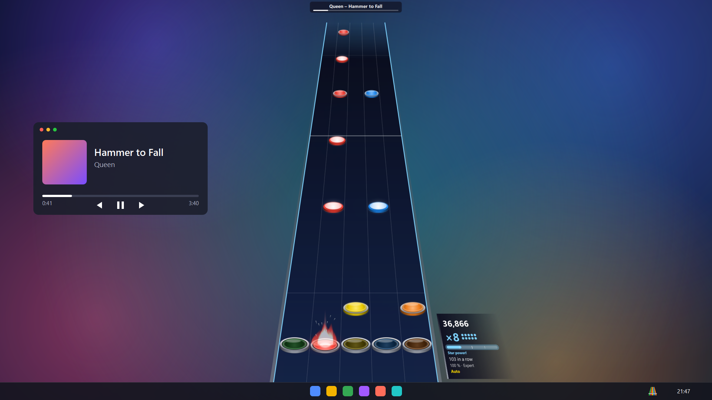

<div align="center">

# 🎸 Music Hero

**Guitar Hero on your desktop, for the songs you already have.**

A transparent note highway that floats over Windows, in sync with the song that's playing,<br>
for a Wii plastic guitar (or the keyboard). The charts are made automatically from your own music.

**English** · [Español](README.es.md)



</div>

## Features

- **Over your desktop, not in a separate game.** A transparent, always-on-top window that lets mouse clicks through. Show or hide it with a global hotkey (`Ctrl+Alt+H`) and keep using your PC underneath.
- **Plays along with AIMP.** If a song is playing in AIMP, the game follows it: its position, pauses, jumps and track changes. It measures AIMP's audio delay by itself. There's also a built-in player with a song picker and search.
- **Charts from your own MP3s.** Add your music folder and it makes the charts in the background, one song at a time, with the one you pick going first. Four difficulties, chords, HOPOs, sustains and star power phrases.
- **Synced lyrics** under the highway, when the song has them.
- **Wii guitar** through the Wiimote, paired from the app itself (no PIN to type), or the keyboard. Tilt the guitar up for **star power**.
- **High scores** per song and difficulty, latency calibration, rebindable keys, English and Spanish.

## How the charts are made

Nothing is made by hand: the models do it alone, so it works with any song.

1. **Demucs** (`htdemucs_6s`) separates the song into stems: guitar, bass, drums, vocals, piano and other.
2. **Beat This!** finds the beats and bars.
3. **OnsetNet**, a model of our own trained on thousands of community charts, decides where the notes go in each difficulty and which frets to use.
4. Lyrics text comes from **LRCLIB** and is timed word by word with **stable-ts** (Whisper) on the vocal stem.

With an NVIDIA graphics card a song takes about a minute. Without one it runs on the CPU and takes several minutes.

## Requirements

- Windows 11, 64-bit. Windows 10 should work but hasn't been tested.
- For fast charts: an NVIDIA graphics card with driver 580 or newer. Otherwise it runs on the CPU.
- Disk space for the generation engine, downloaded the first time it's needed: about 5 GB with NVIDIA, 3 GB without.
- To play: a Wii guitar plugged into a Wiimote and Bluetooth on the PC, or just the keyboard.
- Optional: [AIMP](https://www.aimp.ru/) to play along with your usual player.

## Install

There's no published release yet. To build the installer yourself, see [Build](#build).

Once installed:

1. Open Music Hero. The welcome screen asks for your **music folder**.
2. The first time, it offers to install the **generation engine** and tells you how much it will download.
3. **Pair the guitar** from the welcome screen or *Settings → Guitar and keys*: press the red sync button under the Wiimote's battery cover.
4. Pick a song as soon as the first chart is ready, or play something in AIMP and press `Ctrl+Alt+H`.

## Controls

| Keyboard | Guitar | Action |
| --- | --- | --- |
| `A` `S` `D` `F` `G` | Frets | Green, red, yellow, blue, orange |
| `↑` `↓` | Strum bar | Strum (in menus: move) |
| `Space` · right-click on the highway | `+` | Menu / pause |
| `Tab` | `−` | Change difficulty without stopping |
| `E` | Tilt the guitar up | Star power |
| `Backspace` | | Restart the song |
| `Ctrl+Alt+H` | Wiimote `A` | Show / hide (works everywhere) |
| `Ctrl+Alt+Q` | | Quit |
| | Wiimote `1` / `2` / `Home` | Next / previous / random song |

Keys can be changed in *Settings → Guitar and keys*. When the game is hidden your keyboard is yours again (with the built-in player, the song pauses; AIMP keeps playing). The icon next to the clock shows the library status and quits the game.

## Run from source

You need [uv](https://docs.astral.sh/uv/). The project uses two separate environments: a light one for the app and a heavy one for the generator (PyTorch with CUDA).

```sh
uv sync --project app
uv sync --project generator                       # downloads PyTorch with CUDA (~3 GB)

uv run --project app play                         # the game (song picker)
uv run --project app play --hidden                # hidden; Ctrl+Alt+H shows it and follows AIMP
uv run --project generator generate "<song.mp3 or folder>"   # charts into out/charts/
uv run --project generator lyrics                 # synced lyrics for every chart
```

Tests (no GPU needed):

```sh
uv run --project app --with pytest pytest app/tests
uv run --project generator --with pytest --with jsonschema pytest tests
```

> **Note:** the trained OnsetNet model (`models/best.pt`) isn't published yet; it will be on Hugging Face. Without it, `generate` falls back to rules and makes the Expert difficulty only.

## Build

```sh
winget install JRSoftware.InnoSetup               # once
uv run --project app --with pyinstaller python packaging/build.py
```

This produces the app folder in `build/dist/Music Hero/` and the installer `build/installer/MusicHero-Setup-<version>.exe`. The installer doesn't need administrator rights. It includes the OnsetNet model, so you need `models/best.pt` to build it. The generation engine isn't inside: the app downloads it the first time.

## Project layout

| Folder | Contents |
| --- | --- |
| `app/` | The game: overlay (PySide6 + Qt Quick), gameplay, Wii guitar over HID, AIMP, library, installer of the engine |
| `generator/` | The generation engine: Demucs, beats, OnsetNet, lyrics, the `generate` / `lyrics` / `engine` commands |
| `shared/` | JSON schemas of `chart.json` and `lyrics.json` |
| `packaging/` | PyInstaller and Inno Setup |
| `tools/` | Diagnostics, training dataset and model evaluation ([details](tools/README.md)) |
| `ROADMAP.md` | Phases and status (in Spanish) |

## Status

Phases 0–6 are done: the game, the chart generator, lyrics, AIMP sync, star power and high scores. Phase 7, so that other people can install it, is almost finished. What's left: testing the installer on a clean Windows, publishing the model and a version for GPUs that aren't NVIDIA (ONNX/DirectML). Details in [ROADMAP.md](ROADMAP.md).

## Acknowledgements

- [Demucs](https://github.com/facebookresearch/demucs) for separating the instruments.
- [Beat This!](https://github.com/CPJKU/beat_this) for beats and bars.
- [Basic Pitch](https://github.com/spotify/basic-pitch) for note transcription.
- [stable-ts](https://github.com/jianfch/stable-ts) and [Whisper](https://github.com/openai/whisper) for timing the lyrics, and [LRCLIB](https://lrclib.net/) for the lyrics text.
- [Chorus Encore](https://www.enchor.us/) and its community charters, whose charts were used to train OnsetNet. None of their charts are distributed here.
- [YARG](https://github.com/YARC-Official/YARG) and Clone Hero as references for timing windows, HOPOs and the `.chart` format.

## License

The code is under the [MIT License](LICENSE). The trained OnsetNet model will be published separately under [CC BY-NC 4.0](https://creativecommons.org/licenses/by-nc/4.0/) (no commercial use), because it was trained on community charts.
